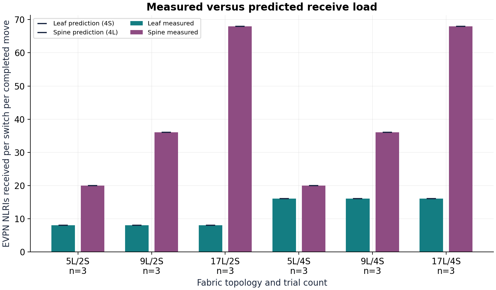
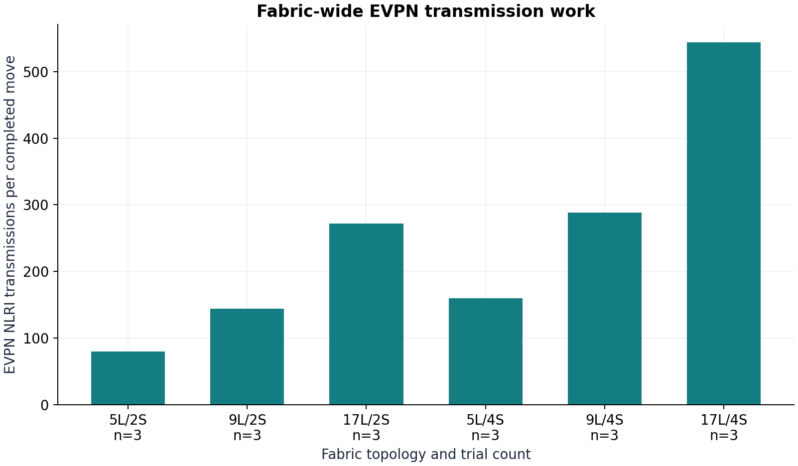

# Cisco Capstone Experiment 1 — EVPN route amplification

## Sponsor conclusion

Across 18 fresh Colima trials and 108 completed single-robot roams, **every leaf received exactly 4 × spines and every spine received exactly 4 × leaves EVPN NLRIs per move**. Fabric-wide work rose from **80 to 544 NLRI transmissions per move** from 5×2 to 17×4. The tested relationship was linear in either dimension at a fixed value of the other (8 × leaves × spines fabric-wide). The measurements quantify control-plane work for a completed, isolated roam. Throughput, latency under load, and production failure thresholds remain outside this dataset.



## Results

| Leaves | Spines | Trials | Completed moves | Leaf RX per move | Spine RX per move | Fabric NLRI transmissions per move | BGP UPDATE messages per move |
|---:|---:|---:|---:|---:|---:|---:|---:|
| 5 | 2 | 3 | 18 | 8 | 20 | 80 | 60 |
| 9 | 2 | 3 | 18 | 8 | 36 | 144 | 108 |
| 17 | 2 | 3 | 18 | 8 | 68 | 272 | 204 |
| 5 | 4 | 3 | 18 | 16 | 20 | 160 | 120 |
| 9 | 4 | 3 | 18 | 16 | 36 | 288 | 216 |
| 17 | 4 | 3 | 18 | 16 | 68 | 544 | 408 |

**Calibration.** Seed 1 at 5×2 completed 6 moves, with 8 RX NLRIs at each leaf and 20 at each spine per move, matching Pradeep's reference. The move log confirmed break-before-make and the stability gate. All ten links were captured. The quiet window contained zero UPDATEs, every directed session reconciled with FRR's send and receive counters, and there were zero capture gaps. The primary matrix used this same configuration.

All three seeds gave identical receive and transmit counts within each topology. The old leaf, new leaf, uninvolved robot leaves and controller leaf each had the same RX and TX totals per move. Spines had the same RX and TX totals within their role. These are measured across individual switch/move observations, including the sender and controller, and their within-role sample standard deviation was zero. Propagation direction and route ownership still differed by role.

## What drives the amplification

Each destination leaf advertised two original Type-2 NLRIs (MAC and MAC/IP), and each prior leaf withdrew two, on every attached spine session. The captures identified the origin in the route distinguisher. Across the matrix, the 26,784 robot NLRI transmissions split into 1,296 originating transmissions, 12,096 spine deliveries to other leaves, 1,296 spine echoes back to the NLRI's origin, and 12,096 leaf re-advertisements toward spines. Echoes plus re-advertisements accounted for **50%** of measured transmissions. The additional work was split equally between origin/delivery traffic and redundant propagation. The controller leaf also re-advertised routes. All counted NLRIs belonged to the moving robot, and the 20,088 UPDATE messages carried 1.33 EVPN NLRIs per UPDATE on average. The capture also showed zero UPDATEs after the stability gate or during cooldown.



## What carries over to other fabrics

- **Adding leaves at a fixed spine count** increases each spine's work linearly. Each added leaf receives the same number of NLRIs as the other leaves and contributes another copy of each change to every spine. Each existing leaf's RX count is flat.
- **Adding spines at a fixed leaf count** increases each leaf's work linearly. Each existing spine's RX count is flat. The fabric has twice the adjacencies when the spine count rises from two to four, which doubles the fabric-wide transmissions in this configuration.
- **Hardware and timing.** The 5×2 calibration matched the Dell reference for switches in both roles. The measured route counts and echo/re-advertisement breakdown are consistent with the topology and configured propagation policy for fully settled moves. BGP message packing can change with update timing and configuration. Wall-clock convergence, queue buildup, achievable move rate, and failure thresholds depend on the platform and workload.
- **Connection to the overload experiments.** Pradeep's 5×2 Dell runs also measured 20 spine RX and 8 leaf RX routes per delivered move up to 2,000 offered moves/s. Under heavier load, the observed per-move counts fell as intermediate changes were superseded, and some robots remained on the wrong leaf after queues drained. Experiment 1 measures the work when each move settles before the next. The sequence-number tie and stale forwarding observed under load sit outside this workload. [Pradeep's Experiments 4 and 5](../../../../../team-handoff/nov_17_pradeep_RESULTS.md)
- **Projection.** If all adjacencies and the same four route changes and echo/re-advertisement behavior persist, the measured relationship projects to 16 RX NLRIs per leaf, 128 per spine, and 1,024 fabric transmissions per isolated roam at 32 leaves and four spines. That is an extrapolation of route work. Larger topologies, concurrent movers, changed route propagation policy, and production hardware capacity were outside the validation range.

## Figures

1. [Leaf RX by spine count](graphs/01_leaf_rx_vs_spines.png)
2. [Spine RX by leaf count](graphs/02_spine_rx_vs_leaves.png)
3. [Measured and predicted receive load](graphs/03_measured_vs_predicted.png)
4. [BGP UPDATE messages and EVPN NLRI transmissions](graphs/04_updates_vs_nlris.png)
5. [Fabric-wide route transmissions](graphs/05_fabric_transmissions.png)
6. [Trial values and min–max ranges](graphs/06_trial_variation.png)

## Method and audit

- The Part A generator built each trial from scratch. The last leaf hosted the controller. One robot used the same IP (`45.0.0.50`) and MAC (`02:52:00:00:00:00`) throughout. Stationary endpoint radios were disabled before the measurement. The seed chose the initial attachment and each next robot leaf, excluding the current leaf.
- The old radio went down before the new one came up. The AP uplinks stayed up. Each attach cleared the robot's cached gateway neighbor and used Pradeep's repeat announcement command (`ping -c 4 -i 0.25 -W 1 -q 45.0.0.1`). DAD was verified disabled on every leaf. Captured running configurations preserve the FRR datacenter eBGP advertisement interval (default 0 s) and default sender-AS-path loop detection.
- The next move waited for the target leaf to own the local MAC, all other robot leaves to select its VTEP, and the controller's installed VRF500 robot /32 to select that VTEP exclusively. These views had to stay consistent for at least two seconds. A failed check stopped the sequence and recorded a failed move.
- Each trial captured every leaf–spine link once, after the initial routes were verified. The 10-second quiet control preceded the first move, and a 15-second cooldown followed the last. The audit compared decoded UPDATE counts with FRR transmit and receive counters in both directions on every session and checked for session resets and TCP reassembly gaps. The per-move decoder attributes each message to the interval starting at a recorded move's start and ending at the next move's start or the end of the cooldown.
- Each decoded EVPN NLRI on a directed adjacency counts as one transmission, whether advertised or withdrawn. Summing RX across all devices counts each transmission once. UPDATE counts refer to reassembled BGP messages. The per-switch files record RX and TX independently. The installed /32 was a completion check. Wire counts quantify control-plane propagation and include copies that a receiver may discard.

The Colima VM ran on an Apple M4 (Mac16,1) with macOS 27.0.1, six vCPUs and 8 GiB of configured RAM. The test container used Linux 6.8.0-117-generic and FRR 10.8.0-dev-my-manual-build.

## Reproduce and audit

From the repository root on a fresh checkout containing the Part A and Part B files and the original `team-handoff/guna/mobility_tools.tar.gz` archive, start the privileged Colima `frr-dev` container with the repository mounted at `/home/frr/frr`. Install Matplotlib in the Python environment used for analysis. The runner refuses to overwrite an existing trial. Its `trial SIZE SEED` mode runs one fresh fabric.

```bash
results=doc/capstone/experiment-results/breakpoint360/experiment1
bash "$results/reproduce.sh" calibration
bash "$results/reproduce.sh" matrix
python3 "$results/analyze.py" --archive team-handoff/guna/mobility_tools.tar.gz
```

Verify the preserved capture and trial files for this dataset with `(cd "$results" && shasum -a 256 -c SHA256SUMS)`.

- [results.csv](results.csv) contains the required trial table plus transmission and message totals.
- [per_move_devices.csv](per_move_devices.csv) identifies source, destination, uninvolved, controller, and spine RX and TX for each move. [role_summary.csv](role_summary.csv) gives the observed ranges and sample standard deviations.
- [per_move_sessions.csv](per_move_sessions.csv) gives directed-session advertisements, withdrawals, and propagation classifications. The route distinguisher identifies the original leaf in each robot NLRI.
- [trials/](trials/) contains the individual pytest logs, running configurations, `truth.csv`, `meta.json`, shared-counter `counts.csv` and `timeline.csv`, and raw `bgp_capture/*.pcap` files. [host_info.txt](host_info.txt) records the Mac and container image. The Linux kernel, FRR version, and capture audit are in the trial metadata.
