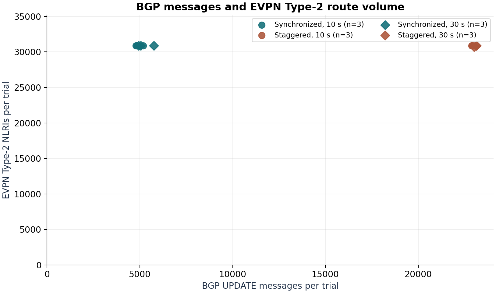
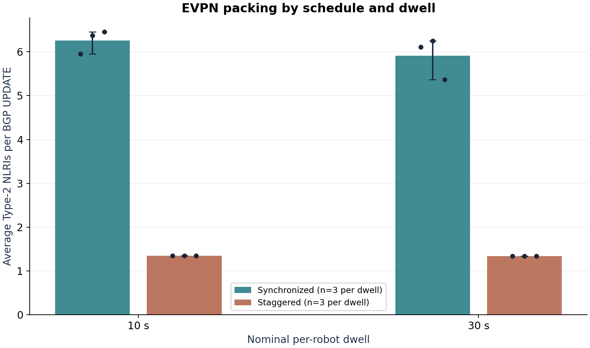
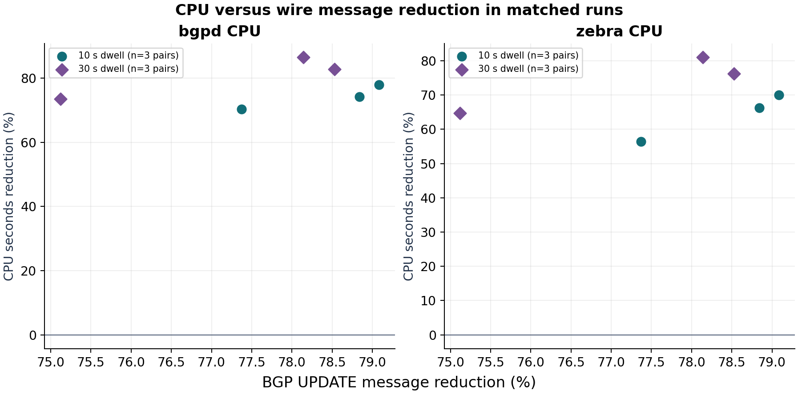

# Cisco Capstone Experiment 2 — Synchronized vs. staggered mobility

Synchronized mobility sent **75.1% to 79.1% fewer BGP UPDATE messages** than staggered mobility across six matched pairs. Total Type-2 NLRI volume differed by at most **0.5%** within a pair. The main effect was packing roughly the same route volume into fewer messages. The study completed 4,608 inter-leaf attachments across 12 trials on the 5-leaf, 2-spine Colima fabric.

## Results

| Dwell | Schedule | Trials | Moves | Mean UPDATEs | Mean Type-2 NLRIs | Mean NLRIs/UPDATE | Mean bgpd CPU s | Mean zebra CPU s | Final leaf5 routes correct |
|---:|---|---:|---:|---:|---:|---:|---:|---:|---:|
| 10 s | Synchronized | 3 | 1,152 | 4,939 | 30,880 | 6.26 | 0.84 | 0.58 | 192/192 |
| 10 s | Staggered | 3 | 1,152 | 22,901 | 30,880 | 1.35 | 3.27 | 1.64 | 192/192 |
| 30 s | Synchronized | 3 | 1,152 | 5,251 | 30,880 | 5.91 | 1.23 | 0.90 | 192/192 |
| 30 s | Staggered | 3 | 1,152 | 23,091 | 30,827 | 1.34 | 6.89 | 3.66 | 192/192 |

Move and final correctness totals are sums over three seeds. Message, NLRI, packing and CPU columns are means of the individual trial values. Each trial delivered 384 attachments. Each pair used the same placements and source/destination sequence.

| Dwell | Seeds | BGP UPDATE reduction | Type-2 NLRI change | bgpd CPU seconds reduction | zebra CPU seconds reduction |
|---:|---:|---:|---:|---:|---:|
| 10 s | 3 | +77.4% to +79.1% | 0.0% | +70.3% to +78.0% | +56.4% to +70.0% |
| 30 s | 3 | +75.1% to +78.5% | +0.0% to +0.5% | +73.5% to +86.6% | +64.7% to +81.1% |

The paired reductions are the minimum and maximum over three seeds. Positive reduction means the synchronized trial used less than its matched staggered trial. The NLRI column instead reports the signed percentage change from staggered to synchronized.

## What packing changed

- **Message-level work fell.** Fewer UPDATEs reduce the number of BGP messages the fabric has to build and receive for this sequence. The Type-2 count includes individual advertisements and withdrawals carried by those messages. The counts measure received wire work, including repeated routes a recipient can reject, and cannot determine how often a route was installed in the kernel. Robot-specific Type-2 traffic was 80 transmitted NLRIs per attachment across the 12 trials. The decoder classified robot routes by MAC and identified 0–160 non-robot Type-2 NLRIs per trial, which are included in the all-Type-2 totals.
- **Measured CPU is a separate outcome.** Synchronized trials used fewer aggregate CPU seconds in 6/6 bgpd pairs and 6/6 zebra pairs. CPU seconds are estimated from roughly one-second process samples, summed across all seven switches from the first movement window through cooldown. Samples at the window boundary are weighted by their overlap. The mean and peak utilization columns in the CSV use percent of one core, summed across switches. A peak here is a sampled average, so short synchronized CPU spikes may be smoothed over. Scheduling, queueing, timing, and packing changed together. The comparison cannot assign the observed CPU difference to packet processing alone.
- **Forwarding was checked independently.** The route monitor observed the expected leaf5 VTEP after 4,608/4,608 attachments. The final Linux FIB selected the expected VTEP for 768/768 robot trial endpoints. The [trial CSV](results_exp2.csv) keeps these checks distinct from wire counts and controller probe losses.

## Connection to Pradeep's overload results

Pradeep's Dell experiments used much faster injected mobility. At light offered load they saw the same 5×2 amplification measured in Experiment 1. Under overload, some intermediate route changes were superseded before transmission and some robots remained on stale paths after the queues drained, consistent with the MAC-mobility sequence tie. That mechanism can reduce the NLRI count itself as correctness degrades. Here, similar NLRI volume traveled in fewer messages. The shortest observed spacing between measured roams of the same robot was 9.78 s at 10-second dwell and 29.54 s at 30-second dwell. Bursts from different robots and rapid repeated moves by the same robot are distinct stressors. Packing gains at this scale do not establish an overload threshold or a mitigation for the sequence tie. [Pradeep's overload findings](../../../../../team-handoff/nov_17_pradeep_RESULTS.md)

## Controls and audit

- Fresh topology per trial, 64 robots, BBM handoff, DAD disabled, repeat gateway announcements, default BGP behavior, six rounds per seed and a 15-second cooldown. Quiet control and capture used the same window definitions within each pair.
- Every run had 10 captured links. Captured UPDATE counts reconciled with FRR's per-device counters. Across 12 trials there were 0 TCP reassembly gaps and 28 quiet-window UPDATEs, all in the 30-second staggered seed 2 rerun. They carried 160 non-robot Type-2 withdrawals and were outside the movement totals. This explains why that run's total Type-2 count is 160 lower while the robot count is identical. UPDATE totals are decoded BGP messages carried over TCP.
- Capture quality excluded staggered-seed-1-attempt-1 at 30 s (5 capture gaps), staggered-seed-2-attempt-1 at 30 s (4 capture gaps). Their evidence is in [rejected/](rejected/). The affected seeds were rerun on fresh topologies with the same workload and FRR settings. The table uses the gap-free replacements. The packet recorder used a larger receive buffer in 3 accepted trials. The buffer adjustment retained the BGP packet selection, decoding, and counter reconciliation.
- The run used the privileged Colima `frr-dev` container on Apple M4 hardware, with six vCPUs and about 8 GiB of VM RAM. The VM ran Linux 6.8.0-117-generic with FRR 10.8.0-dev-my-manual-build. The CPU measurements describe this VM and workload. Three matched seeds at each dwell support the observed packing comparison. A hardware-independent CPU ratio or production limit would require separate testing.

[All 12 trials](results_exp2.csv) · [Six matched comparisons](paired_exp2.csv) · [Runner and evidence layout](README.md)

To regenerate the tables and plots from the preserved samples and trial summaries, run `python3 aggregate_exp2.py` in this directory with Matplotlib installed and the handoff decoder archive available at its repository path.
