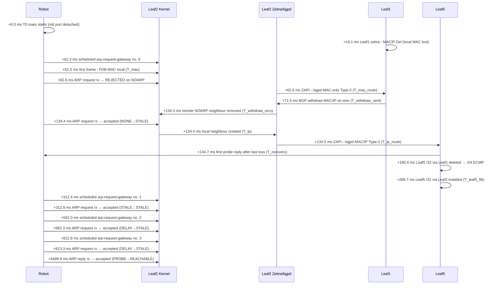

# 360° EVPN Host-Mobility & IP-Relearning Findings

Generated by `analyze_360_roadmap.py` from 120 trial trace(s) under `results`. Every trial is a fresh two-spine/five-leaf topology in the privileged `frr-dev` container; host11 (45.0.0.11, 00:00:00:00:00:11) roams Leaf1→Leaf2 at T0 while the controller (20.0.0.51, behind Leaf5) probes it with ICMP. Times are ms after T0 on CLOCK_MONOTONIC.

## 1. Executive summary

* **Ordering test (Workstream A, n=50):** local IP neighbour (T_ip) appeared **after** the remote NOARP entry was removed (T_withdraw_recv) in 45 run(s), **before** it in 0, and never within the window in 5.
* **Kernel evidence for Hypothesis A:** in 36/36 runs where a robot ARP reached Leaf2 before the withdrawal was applied, `__neigh_update()` was called on the existing `NOARP` extern-learned entry with non-admin flags and returned non-zero (rejected). 0 run(s) contradicted A (an ARP accepted while NOARP, or a local entry before withdrawal).
* **Dominant explanation of the relearning gap (per run):** C = 41, A (unrecovered) = 5, A = 4.
* **Propagation (Hypothesis C component):** Leaf2 ZAPI MAC/IP add → Leaf5 /32 install median 153.3 ms (n=99). bgpd batches route processing in a work queue with `spec.hold = 50` ms (`bgpd/bgp_route.c`, `bgp_process_queue_init`), applied at Leaf2, each spine and Leaf5.

## 2. Method, definitions and instrumentation

**Observers (event-driven inside the window; no vtysh/`ip` polling between T0 and window end):**

* rtnetlink listener in every router, host11 and the controller (`nlmon.py`): link, neighbour, AF_BRIDGE FDB (= `bridge monitor fdb`), IPv4 route and nexthop groups, stamped with CLOCK_MONOTONIC at userspace receipt; per-socket drop counters recorded.
* Kernel kprobes in a private tracefs instance with `trace_clock=mono`: `__neigh_update` (entry: old/new NUD state, update flags, ext-learned flag, IPv4 key, device, netns inode; return value) and `arp_process` (opcode, sender/target IP, device, netns).
* FRR debug logs at µs precision: `debug zebra events`, `debug zebra vxlan`, `debug bgp zebra`, `debug bgp updates in/out`. FRR 10.8 has no plain `debug bgp evpn`; the ZAPI MACIP send/receive and EVPN UPDATE lines come from the zebra-vxlan, bgp-zebra and bgp-updates debugs.
* dumpcap per node (per-interface pcapng: underlay, L2/L3 VNI bridges and VXLAN devices); BGP UPDATEs decoded per NLRI with tshark; probe path from VXLAN outer headers.
* Controller ICMP probes (10 Hz for host11; 5 Hz per robot when 65 targets) with the send time in the payload; `/proc` CPU sampler for zebra/bgpd every 250 ms (pidstat-equivalent, the only sampled observer).

**Clock:** all namespaces share one kernel, so CLOCK_MONOTONIC is common. FRR logs and pcapng use CLOCK_REALTIME and are mapped with the REALTIME−MONOTONIC offset measured (tightest of 2000 bracketed reads) before and after each trial.
Offset drift across a trial: max 0.1 µs; bracket ≤ 1 µs. Log stamps have 1 µs resolution; kprobe display resolution is 1 µs; netlink times are userspace receipt times.

**Milestones (target robot M=00:00:00:00:00:11, I=45.0.0.11; S=Leaf1, D=Leaf2):**

| Symbol | Definition (first event at t ≥ T0) | Source |
|---|---|---|
| T0 | first roam command (BBM: Leaf1 `nomaster`; MBB: creation of the new link) | harness |
| T_mac | FDB entry for M on a Leaf2 access port (not VXLAN, not extern_learn) | netlink |
| T_mac_route | Leaf2 zebra `Send MACIP Add` MAC-only (IP null) to bgpd | zebra log |
| T_withdraw_sent | Leaf1 BGP UPDATE with MP_UNREACH for [M,I] on the wire (fallback: bgpd log) | pcap |
| T_withdraw_recv | Leaf2 extern-learned NOARP entry for I removed: admin `__neigh_update` NOARP→FAILED, or RTM_DELNEIGH, whichever first | kprobe/netlink |
| T_ip | Leaf2 local neighbour for I created: accepted non-admin `__neigh_update` (kernel time) matching the first RTM_NEWNEIGH with lladdr M, state REACHABLE/STALE/DELAY/PROBE, not extern_learn | kprobe (netlink fallback) |
| T_ip_route | Leaf2 zebra `Send MACIP Add` with IP I (after T_ip) | zebra log |
| T_leaf5_fib | Leaf5 RTM_NEWROUTE I/32 table 500 via 10.0.0.2 | netlink |
| T_recovery | receive time of the first successful probe after the last lost probe | probe |
| ECMP fallback | total time Leaf5 had no I/32 (traffic follows /24 Type-5 ECMP) | netlink |

ΔT_relearn = T_ip − T_mac; ΔT_withdraw_gap = T_withdraw_recv − T_mac; ΔT_adv_delay = T_ip_route − T_ip; ΔT_unreachable = T_recovery − T0 (0 when no probe was lost; window length and *censored* when the last probes were still lost).

**Hypothesis operationalisation (per run, from kprobe evidence):**

* **A — blocked by NOARP:** ≥1 robot ARP processed at Leaf2 before T_withdraw_recv whose `__neigh_update` saw old state NOARP and returned non-zero. *Contradicted* if such an ARP was accepted, or T_ip < T_withdraw_recv.
* **B — independent asynchronous events:** the local entry was created by an ARP that arrived after T_withdraw_recv and no earlier ARP was rejected (the gap is the wait for the next ARP).
* **C — Zebra/propagation delay:** during the Leaf5 /32 absence, time from T_ip (or the /32 delete, if later) to T_leaf5_fib exceeds the time waiting for T_ip.
* **Dominant:** compare wait-for-relearn vs propagation; the wait is labelled A if a rejection occurred, otherwise B.

**Trials analysed:** A:burst n=10, A:delayed n=10, A:immediate n=10, A:none n=10, A:ping n=10, B:baseline n=5, B:low64 n=5, B:mob250 n=5, B:scale1000 n=5, C:roam64-staggered n=5, C:roam64-sync n=5, D:BBM n=10, D:MBB 100 ms n=10, D:MBB 250 ms n=10, D:MBB 500 ms n=10

## 3. Workstream A — root cause and state-machine isolation

### 3.1 Delta calculation matrix (median [min–max] ms)

| Pattern | n | ΔT_relearn | ΔT_withdraw_gap | ΔT_adv_delay | ΔT_unreachable | T_ip after T_withdraw_recv | lost probes (median) |
|---|---|---|---|---|---|---|---|
| (a) No ARP (silent host) | 10 | 83.3 [74.0–87.2] (n=8) | 78.5 [70.0–83.5] (n=10) | 0.1 [0.1–0.7] (n=8) | 135.1 [133.1–30000.0] (n=10) | 8/10 | 1 |
| (b) Immediate ARP (0 ms) | 10 | 80.2 [73.8–90.7] (n=7) | 72.0 [53.5–80.8] (n=10) | 0.1 [0.1–0.9] (n=7) | 138.4 [130.6–30000.0] (n=10) | 7/10 | 1 |
| (c) Delayed ARP (300 ms) | 10 | 83.4 [65.5–299.6] (n=10) | 72.9 [64.0–80.9] (n=10) | 0.2 [0.1–1.0] (n=10) | 135.0 [129.5–139.0] (n=10) | 10/10 | 1 |
| (d) Burst ARP (0/250/500/750 ms) | 10 | 81.1 [71.9–250.8] (n=10) | 73.5 [64.7–82.4] (n=10) | 0.1 [0.1–0.6] (n=10) | 135.4 [125.4–141.0] (n=10) | 10/10 | 1 |
| (e) Unicast ping to gateway (0/250/500/750 ms) | 10 | 250.3 [249.6–253.2] (n=10) | 71.2 [62.8–80.9] (n=10) | 0.4 [0.3–1.1] (n=10) | 129.8 [0.0–142.1] (n=10) | 10/10 | 1 |

### 3.2 Event timeline per run (ms after T0)

| Run | T_mac | T_mac_route | T_withdraw_sent | T_withdraw_recv | T_ip | T_ip_route | T_leaf5_fib | T_recovery | order | ARPs at Leaf2 before withdrawal (rejected) | T_ip trigger | relearn vs scheduled ARP |
|---|---|---|---|---|---|---|---|---|---|---|---|---|
| A-burst-01 | 52.6 | 52.8 | 62.0 | 125.0 | 129.3 | 129.6 | 278.4 | 129.7 | AFTER WD | 1 (1) | robot-initiated request | after scheduled #1 |
| A-burst-02 | 62.5 | 62.6 | 71.5 | 134.3 | 134.4 | 134.5 | 289.7 | 134.7 | AFTER WD | 1 (1) | robot-initiated request | after scheduled #1 |
| A-burst-03 | 54.7 | 56.3 | 67.3 | 130.1 | 305.5 | 306.1 | 475.4 | 125.4 | AFTER WD | 2 (2) | deliberate stimulus | after scheduled #2 |
| A-burst-04 | 50.1 | 50.7 | 62.9 | 125.0 | 140.0 | 140.2 | 280.6 | 140.5 | AFTER WD | 1 (1) | robot-initiated request | after scheduled #1 |
| A-burst-05 | 59.2 | 59.6 | 67.3 | 130.7 | 135.6 | 135.7 | 285.8 | 135.9 | AFTER WD | 1 (1) | robot-initiated request | after scheduled #1 |
| A-burst-06 | 61.4 | 61.9 | 62.5 | 126.1 | 136.7 | 136.8 | 282.1 | 137.1 | AFTER WD | 1 (1) | robot-initiated request | after scheduled #1 |
| A-burst-07 | 42.5 | 42.6 | 61.2 | 125.0 | 134.8 | 134.9 | 280.4 | 135.0 | AFTER WD | 1 (1) | robot-initiated request | after scheduled #1 |
| A-burst-08 | 56.5 | 57.2 | 67.1 | 131.2 | 131.8 | 131.9 | 284.9 | 132.1 | AFTER WD | 1 (1) | robot-initiated request | after scheduled #1 |
| A-burst-09 | 54.7 | 54.7 | 61.0 | 123.1 | 140.2 | 140.8 | 278.1 | 141.0 | AFTER WD | 1 (1) | robot-initiated request | after scheduled #1 |
| A-burst-10 | 48.9 | 49.0 | 61.4 | 124.6 | 137.8 | 137.9 | 279.1 | 138.3 | AFTER WD | 1 (1) | robot-initiated request | after scheduled #1 |
| A-delayed-01 | 80.6 | 80.8 | 89.3 | 153.6 | 379.0 | 380.0 | 544.5 | 139.0 | AFTER WD | 1 (1) | deliberate stimulus | after scheduled #1 |
| A-delayed-02 | 50.4 | 50.9 | 68.1 | 131.3 | 134.7 | 134.9 | 285.2 | 135.7 | AFTER WD | 0 (0) | robot-initiated request | before first scheduled |
| A-delayed-03 | 64.4 | 64.9 | 71.2 | 134.5 | 363.4 | 363.7 | 531.6 | 130.6 | AFTER WD | 1 (1) | deliberate stimulus | after scheduled #1 |
| A-delayed-04 | 60.3 | 60.3 | 73.2 | 136.7 | 358.8 | 359.6 | 529.6 | 135.2 | AFTER WD | 1 (1) | deliberate stimulus | after scheduled #1 |
| A-delayed-05 | 53.6 | 53.7 | 64.3 | 126.4 | 131.9 | 132.1 | 282.5 | 132.4 | AFTER WD | 0 (0) | robot-initiated request | before first scheduled |
| A-delayed-06 | 55.6 | 55.7 | 68.9 | 133.0 | 138.1 | 138.3 | 289.2 | 138.8 | AFTER WD | 0 (0) | robot-initiated request | before first scheduled |
| A-delayed-07 | 61.5 | 61.6 | 64.7 | 127.3 | 134.9 | 135.0 | 282.0 | 135.3 | AFTER WD | 0 (0) | robot-initiated request | before first scheduled |
| A-delayed-08 | 53.0 | 53.7 | 64.3 | 128.6 | 132.0 | 132.2 | 283.0 | 132.5 | AFTER WD | 0 (0) | robot-initiated request | before first scheduled |
| A-delayed-09 | 83.2 | 83.5 | 85.1 | 148.9 | 382.9 | 383.2 | 553.5 | 134.8 | AFTER WD | 1 (1) | deliberate stimulus | after scheduled #1 |
| A-delayed-10 | 63.5 | 63.9 | 64.7 | 127.5 | 128.9 | 129.1 | 283.3 | 129.5 | AFTER WD | 0 (0) | robot-initiated request | before first scheduled |
| A-immediate-01 | 80.0 | 80.2 | 69.8 | 133.5 | – | – | – | censored | no in window | 2 (2) | – | not recovered |
| A-immediate-02 | 87.1 | 87.8 | 75.6 | 142.2 | – | – | – | censored | no in window | 2 (2) | – | not recovered |
| A-immediate-03 | 67.5 | 70.0 | 68.8 | 133.9 | – | – | – | censored | no in window | 2 (2) | – | not recovered |
| A-immediate-04 | 52.6 | 53.1 | 67.3 | 130.7 | 132.8 | 132.9 | 284.0 | 133.0 | AFTER WD | 1 (1) | robot-initiated request | after last scheduled |
| A-immediate-05 | 49.6 | 50.1 | 65.7 | 130.4 | 139.3 | 140.2 | 286.2 | 139.9 | AFTER WD | 1 (1) | robot-initiated request | after last scheduled |
| A-immediate-06 | 54.1 | 54.1 | 66.1 | 128.4 | 130.3 | 130.5 | 283.9 | 130.6 | AFTER WD | 1 (1) | robot-initiated request | after last scheduled |
| A-immediate-07 | 60.0 | 60.0 | 63.4 | 127.3 | 133.7 | 133.8 | 282.0 | 134.0 | AFTER WD | 1 (1) | robot-initiated request | after last scheduled |
| A-immediate-08 | 48.8 | 49.3 | 66.0 | 129.6 | 139.6 | 140.2 | 285.1 | 140.0 | AFTER WD | 1 (1) | robot-initiated request | after last scheduled |
| A-immediate-09 | 57.0 | 57.8 | 63.2 | 126.7 | 136.2 | 136.3 | 279.9 | 136.5 | AFTER WD | 1 (1) | robot-initiated request | after last scheduled |
| A-immediate-10 | 51.6 | 51.6 | 64.3 | 128.4 | 136.4 | 136.6 | 285.3 | 137.0 | AFTER WD | 1 (1) | robot-initiated request | after last scheduled |
| A-none-01 | 60.4 | 61.5 | 78.9 | 143.7 | 144.1 | 144.2 | 299.3 | 144.5 | AFTER WD | 0 (0) | robot-initiated request | no scheduled ARP |
| A-none-02 | 56.7 | 56.9 | 63.6 | 126.7 | 137.5 | 138.3 | 281.3 | 138.4 | AFTER WD | 0 (0) | robot-initiated request | no scheduled ARP |
| A-none-03 | 53.1 | 53.5 | 68.8 | 131.9 | 134.4 | 134.5 | 288.8 | 134.8 | AFTER WD | 0 (0) | robot-initiated request | no scheduled ARP |
| A-none-04 | 64.6 | 64.8 | 80.1 | 146.5 | – | – | – | censored | no in window | 1 (1) | – | no scheduled ARP; not recovered |
| A-none-05 | 50.7 | 49.6 | 63.2 | 126.7 | 133.8 | 134.4 | 284.0 | 134.2 | AFTER WD | 0 (0) | robot-initiated request | no scheduled ARP |
| A-none-06 | 50.3 | 50.6 | 68.1 | 130.6 | 134.0 | 134.2 | 287.5 | 134.5 | AFTER WD | 0 (0) | robot-initiated request | no scheduled ARP |
| A-none-07 | 58.8 | 59.2 | 66.1 | 128.8 | 132.8 | 132.9 | 288.1 | 133.1 | AFTER WD | 0 (0) | robot-initiated request | no scheduled ARP |
| A-none-08 | 54.9 | 54.8 | 62.3 | 125.7 | – | – | – | censored | no in window | 1 (1) | – | no scheduled ARP; not recovered |
| A-none-09 | 47.8 | 48.4 | 66.3 | 131.3 | 135.1 | 135.2 | 285.6 | 135.5 | AFTER WD | 0 (0) | robot-initiated request | no scheduled ARP |
| A-none-10 | 50.6 | 50.6 | 65.5 | 128.7 | 134.0 | 134.2 | 287.3 | 134.4 | AFTER WD | 0 (0) | robot-initiated request | no scheduled ARP |
| A-ping-01 | 73.7 | 74.1 | 70.7 | 136.5 | 323.2 | 323.5 | 495.1 | 128.9 | AFTER WD | 1 (1) | robot reply to own-leaf ARP probe | after scheduled #2 |
| A-ping-02 | 67.9 | 68.0 | 72.5 | 135.2 | 317.7 | 318.0 | 485.4 | 128.5 | AFTER WD | 1 (1) | robot reply to own-leaf ARP probe | after scheduled #2 |
| A-ping-03 | 51.3 | 51.5 | 64.5 | 127.9 | 304.5 | 304.9 | 472.9 | 134.1 | AFTER WD | 1 (1) | robot reply to own-leaf ARP probe | after scheduled #2 |
| A-ping-04 | 49.5 | 49.6 | 62.4 | 126.1 | 299.6 | 300.1 | 466.3 | 132.4 | AFTER WD | 1 (1) | robot reply to own-leaf ARP probe | after scheduled #2 |
| A-ping-05 | 54.0 | 54.1 | 61.5 | 126.2 | 305.2 | 305.5 | 475.2 | 126.2 | AFTER WD | 1 (1) | robot reply to own-leaf ARP probe | after scheduled #2 |
| A-ping-06 | 46.3 | 46.5 | 63.4 | 127.2 | 297.9 | 299.0 | 467.9 | 130.6 | AFTER WD | 1 (1) | robot reply to own-leaf ARP probe | after scheduled #2 |
| A-ping-07 | 54.3 | 54.5 | 67.4 | 132.4 | 303.9 | 304.3 | 473.3 | 142.1 | AFTER WD | 1 (1) | robot reply to own-leaf ARP probe | after scheduled #2 |
| A-ping-08 | 65.0 | 65.2 | 69.4 | 134.0 | 315.3 | 315.6 | 481.4 | – | AFTER WD | 1 (1) | robot reply to own-leaf ARP probe | after scheduled #2 |
| A-ping-09 | 60.1 | 60.8 | 65.4 | 128.8 | 311.4 | 311.9 | 478.6 | – | AFTER WD | 1 (1) | robot reply to own-leaf ARP probe | after scheduled #2 |
| A-ping-10 | 77.5 | 77.6 | 82.0 | 147.6 | 327.9 | 328.4 | 498.3 | 139.1 | AFTER WD | 1 (1) | robot reply to own-leaf ARP probe | after scheduled #2 |

### 3.3a Race: first robot ARP processed at Leaf2 vs removal of the remote NOARP entry

Race margin = t(first robot ARP processed by Leaf2, kprobe `arp_process`) − T_withdraw_recv. Negative ⇒ the ARP met the extern-learned NOARP entry.

| Pattern | n | race margin median [min–max] ms | ARP first (margin<0) | withdrawal first | first ARP source (counts) | robot first probe rx median ms | robot first ARP tx median ms |
|---|---|---|---|---|---|---|---|
| (a) No ARP (silent host) | 10 | 3.5 [-22.3–10.8] | 2 | 8 | robot-initiated request ×10 | 133.9 | 133.9 |
| (b) Immediate ARP (0 ms) | 10 | -72.0 [-80.8–-53.4] | 10 | 0 | deliberate stimulus ×10 | 133.2 | 55.5 |
| (c) Delayed ARP (300 ms) | 10 | 2.4 [-14.9–7.5] | 4 | 6 | robot-initiated request ×10 | 134.4 | 134.4 |
| (d) Burst ARP (0/250/500/750 ms) | 10 | -73.4 [-82.4–-64.7] | 10 | 0 | deliberate stimulus ×10 | 135.1 | 54.6 |
| (e) Unicast ping to gateway (0/250/500/750 ms) | 10 | -70.6 [-81.0–-62.7] | 10 | 0 | deliberate stimulus ×10 | 129.6 | 57.1 |

### 3.3 ARP pattern matrix — recovery relative to scheduled ARP packets

| Pattern | n | recovered (T_ip in window) | before first scheduled ARP (or none scheduled) | after a scheduled ARP | after last scheduled (+50 ms) | not recovered | T_ip trigger sources |
|---|---|---|---|---|---|---|---|
| (a) No ARP (silent host) | 10 | 8 | 8 | 0 | 0 | 2 | robot-initiated request ×8 |
| (b) Immediate ARP (0 ms) | 10 | 7 | 0 | 0 | 7 | 3 | robot-initiated request ×7 |
| (c) Delayed ARP (300 ms) | 10 | 10 | 6 | 4 | 0 | 0 | robot-initiated request ×6; deliberate stimulus ×4 |
| (d) Burst ARP (0/250/500/750 ms) | 10 | 10 | 0 | 10 | 0 | 0 | robot-initiated request ×9; deliberate stimulus ×1 |
| (e) Unicast ping to gateway (0/250/500/750 ms) | 10 | 10 | 0 | 10 | 0 | 0 | robot reply to own-leaf ARP probe ×10 |

Kernel verdicts for every robot ARP processed by Leaf2 after T0 across Workstream A: 40 rejected (all on NOARP: True), 135 accepted, 165 ignored (no neighbour update, e.g. an ARP reply with no Leaf2 entry while `arp_accept=0`).

Requesters of the ignored robot ARP replies (from the VXLAN outer source of the preceding request seen at Leaf2): leaf3 ×165. Every leaf answers ARP from the same anycast gateway IP/MAC, so a robot reply to another leaf's request is delivered to Leaf2's own SVI and never reaches the requester.

### 3.4 Where probes go while Leaf5 has no /32 (VTEP chosen by Leaf5 × outcome, host11 probes after T0)

| Pattern | leaf1: ok / lost | leaf2: ok / lost | leaf3: ok / lost | leaf4: ok / lost | lost before VXLAN egress |
|---|---|---|---|---|---|
| (a) No ARP (silent host) | 11 / 9 | 2366 / 0 | 8 / 597 | 0 / 0 | 0 |
| (b) Immediate ARP (0 ms) | 10 / 10 | 2074 / 0 | 7 / 894 | 0 / 0 | 0 |
| (c) Delayed ARP (300 ms) | 10 / 10 | 2955 / 0 | 21 / 0 | 0 / 0 | 0 |
| (d) Burst ARP (0/250/500/750 ms) | 10 / 10 | 2958 / 0 | 12 / 0 | 0 / 0 | 0 |
| (e) Unicast ping to gateway (0/250/500/750 ms) | 11 / 8 | 2944 / 0 | 30 / 0 | 0 / 0 | 0 |

## 4. Hypothesis verdict table

| Experiment | n | A supported (NOARP rejection seen) | A contradicted | A not testable (no pre-withdraw ARP) | B supported | C supported | Dominant: A | Dominant: B | Dominant: C | no fallback/no loss |
|---|---|---|---|---|---|---|---|---|---|---|
| A:burst | 10 | 10 | 0 | 0 | 0 | 10 | 0 | 0 | 10 | 0 |
| A:delayed | 10 | 4 | 0 | 6 | 6 | 6 | 4 | 0 | 6 | 0 |
| A:immediate | 10 | 10 | 0 | 0 | 0 | 7 | 3 | 0 | 7 | 0 |
| A:none | 10 | 2 | 0 | 8 | 8 | 8 | 2 | 0 | 8 | 0 |
| A:ping | 10 | 10 | 0 | 0 | 0 | 10 | 0 | 0 | 10 | 0 |
| B:baseline | 5 | 5 | 0 | 0 | 0 | 5 | 0 | 0 | 5 | 0 |
| B:low64 | 5 | 5 | 0 | 0 | 0 | 5 | 0 | 0 | 5 | 0 |
| B:mob250 | 5 | 5 | 0 | 0 | 0 | 5 | 0 | 0 | 5 | 0 |
| B:scale1000 | 5 | 5 | 0 | 0 | 0 | 5 | 0 | 0 | 5 | 0 |
| C:roam64-staggered | 5 | 5 | 0 | 0 | 0 | 5 | 0 | 0 | 5 | 0 |
| C:roam64-sync | 5 | 5 | 0 | 0 | 0 | 1 | 4 | 0 | 1 | 0 |
| D:BBM | 10 | 10 | 0 | 0 | 0 | 10 | 0 | 0 | 10 | 0 |
| D:MBB 100 ms | 10 | 10 | 0 | 0 | 0 | 0 | 10 | 0 | 0 | 0 |
| D:MBB 250 ms | 10 | 10 | 0 | 0 | 0 | 3 | 7 | 0 | 3 | 0 |
| D:MBB 500 ms | 10 | 10 | 0 | 0 | 0 | 0 | 10 | 0 | 0 | 0 |

### 4.1 Withdrawal / advertisement path decomposition (median ms after T0)

| Experiment | n | T_mac_route (Leaf2 ZAPI) | T_withdraw_trigger (Leaf1 ZAPI Del) | T_withdraw_sent (Leaf1 wire) | T_withdraw_recv (Leaf2 kernel) | Leaf1 bgpd: ZAPI→wire | wire→Leaf2 kernel (spine + Leaf2) | T_ip_route→T_leaf5_fib |
|---|---|---|---|---|---|---|---|---|
| A:burst | 10 | 55.5 | 11.5 | 62.7 | 125.6 | 51.5 | 63.1 | 147.2 |
| A:delayed | 10 | 61.0 | 16.5 | 68.5 | 132.2 | 51.7 | 63.4 | 152.6 |
| A:immediate | 10 | 56.0 | 14.4 | 66.0 | 130.0 | 52.0 | 63.8 | 148.2 |
| A:none | 10 | 54.2 | 14.2 | 66.2 | 129.7 | 52.1 | 63.3 | 153.2 |
| A:ping | 10 | 57.6 | 14.5 | 66.4 | 130.6 | 51.9 | 64.2 | 168.5 |
| B:baseline | 5 | 63.1 | 14.2 | 65.2 | 131.1 | 52.1 | 63.3 | 147.3 |
| B:low64 | 5 | 52.0 | 10.7 | 62.2 | 125.2 | 51.6 | 64.5 | 144.3 |
| B:mob250 | 5 | 50.0 | 14.7 | 53.8 | 78.2 | 31.5 | 25.5 | 163.7 |
| B:scale1000 | 5 | 33.9 | 4.2 | 55.5 | 118.3 | 51.0 | 63.2 | 162.4 |
| C:roam64-staggered | 5 | 52.5 | 13.3 | 53.9 | 118.0 | 39.8 | 64.0 | 166.6 |
| C:roam64-sync | 5 | 57.4 | 13.5 | 57.6 | 124.6 | 42.9 | 65.8 | 128.6 |
| D:BBM | 10 | 55.4 | 11.0 | 62.5 | 125.4 | 51.6 | 62.9 | 145.6 |
| D:MBB 100 ms | 10 | 46.9 | 154.2 | 201.7 | 265.3 | 47.7 | 63.4 | – |
| D:MBB 250 ms | 10 | 51.2 | 168.6 | 208.2 | 272.3 | 39.7 | 64.7 | 166.3 |
| D:MBB 500 ms | 10 | 48.6 | 165.3 | 205.8 | 270.1 | 40.5 | 64.4 | 167.4 |

## 5. Statistical distribution summary (every experiment)

Percentiles use linear interpolation; with n≤10 P95/P99 lie between the two largest values and are not tail estimates. Censored values (no recovery in the window) enter as the window length, a lower bound.

### A:burst (n=10)

| Metric (ms) | Min | Median | P95 | P99 | Max | n |
|---|---|---|---|---|---|---|
| ΔT_relearn | 71.9 | 81.1 | 179.5 | 236.6 | 250.8 | 10 |
| ΔT_withdraw_gap | 64.7 | 73.5 | 79.4 | 81.8 | 82.4 | 10 |
| ΔT_adv_delay | 0.06 | 0.15 | 0.62 | 0.62 | 0.62 | 10 |
| ΔT_unreachable | 125.4 | 135.4 | 140.8 | 141.0 | 141.0 | 10 |
| T_ip_route→T_leaf5_fib | 137.3 | 147.2 | 163.0 | 168.0 | 169.3 | 10 |
| Leaf5 ECMP fallback duration | 102.2 | 104.1 | 209.5 | 277.6 | 294.7 | 10 |
| Lost probes (count) | 1 | 1 | 1 | 1 | 1 | 10 |

Lost probes total: 10 of 3000 sent after T0. Leaf5 ECMP fallback duration median: 104.1 ms.

### A:delayed (n=10)

| Metric (ms) | Min | Median | P95 | P99 | Max | n |
|---|---|---|---|---|---|---|
| ΔT_relearn | 65.5 | 83.4 | 299.3 | 299.6 | 299.6 | 10 |
| ΔT_withdraw_gap | 64.0 | 72.9 | 79.3 | 80.6 | 80.9 | 10 |
| ΔT_adv_delay | 0.11 | 0.20 | 0.95 | 1.01 | 1.03 | 10 |
| ΔT_unreachable | 129.5 | 135.0 | 138.9 | 139.0 | 139.0 | 10 |
| T_ip_route→T_leaf5_fib | 147.1 | 152.6 | 170.2 | 170.3 | 170.3 | 10 |
| Leaf5 ECMP fallback duration | 102.9 | 105.6 | 349.1 | 351.7 | 352.3 | 10 |
| Lost probes (count) | 1 | 1 | 1 | 1 | 1 | 10 |

Lost probes total: 10 of 3000 sent after T0. Leaf5 ECMP fallback duration median: 105.6 ms.

### A:immediate (n=10)

| Metric (ms) | Min | Median | P95 | P99 | Max | n |
|---|---|---|---|---|---|---|
| ΔT_relearn | 73.8 | 80.2 | 90.4 | 90.7 | 90.7 | 7 |
| ΔT_withdraw_gap | 53.5 | 72.0 | 80.8 | 80.8 | 80.8 | 10 |
| ΔT_adv_delay | 0.10 | 0.12 | 0.80 | 0.85 | 0.87 | 7 |
| ΔT_unreachable | 130.6 | 138.4 | 30000.0 | 30000.0 | 30000.0 | 10 (3 censored) |
| T_ip_route→T_leaf5_fib | 143.6 | 148.2 | 152.7 | 153.3 | 153.4 | 7 |
| Leaf5 ECMP fallback duration | 102.4 | 105.4 | 29815.3 | 29815.4 | 29815.4 | 10 (3 censored) |
| Lost probes (count) | 1 | 1 | 299 | 299 | 299 | 10 |

Lost probes total: 904 of 3000 sent after T0. Leaf5 ECMP fallback duration median: 105.4 ms.

### A:none (n=10)

| Metric (ms) | Min | Median | P95 | P99 | Max | n |
|---|---|---|---|---|---|---|
| ΔT_relearn | 74.0 | 83.3 | 86.0 | 87.0 | 87.2 | 8 |
| ΔT_withdraw_gap | 70.0 | 78.5 | 83.4 | 83.5 | 83.5 | 10 |
| ΔT_adv_delay | 0.11 | 0.14 | 0.66 | 0.71 | 0.72 | 8 |
| ΔT_unreachable | 133.1 | 135.1 | 30000.0 | 30000.0 | 30000.0 | 10 (2 censored) |
| T_ip_route→T_leaf5_fib | 143.1 | 153.2 | 155.1 | 155.1 | 155.1 | 8 |
| Leaf5 ECMP fallback duration | 102.0 | 106.0 | 29813.4 | 29820.0 | 29821.6 | 10 (2 censored) |
| Lost probes (count) | 1 | 1 | 299 | 299 | 299 | 10 |

Lost probes total: 605 of 2996 sent after T0. Leaf5 ECMP fallback duration median: 106.0 ms.

### A:ping (n=10)

| Metric (ms) | Min | Median | P95 | P99 | Max | n |
|---|---|---|---|---|---|---|
| ΔT_relearn | 249.6 | 250.3 | 252.5 | 253.1 | 253.2 | 10 |
| ΔT_withdraw_gap | 62.8 | 71.2 | 79.6 | 80.6 | 80.9 | 10 |
| ΔT_adv_delay | 0.28 | 0.41 | 0.86 | 1.07 | 1.13 | 10 |
| ΔT_unreachable | 0.0 | 129.8 | 140.8 | 141.9 | 142.1 | 10 |
| T_ip_route→T_leaf5_fib | 165.8 | 168.5 | 170.8 | 171.4 | 171.5 | 10 |
| Leaf5 ECMP fallback duration | 289.3 | 297.3 | 303.6 | 306.6 | 307.4 | 10 |
| Lost probes (count) | 0 | 1 | 1 | 1 | 1 | 10 |

Lost probes total: 8 of 2998 sent after T0. Leaf5 ECMP fallback duration median: 297.3 ms.

### B:baseline (n=5)

| Metric (ms) | Min | Median | P95 | P99 | Max | n |
|---|---|---|---|---|---|---|
| ΔT_relearn | 72.7 | 81.8 | 217.3 | 242.1 | 248.3 | 5 |
| ΔT_withdraw_gap | 61.4 | 67.9 | 77.5 | 78.7 | 79.0 | 5 |
| ΔT_adv_delay | 0.20 | 0.50 | 1.02 | 1.12 | 1.15 | 5 |
| ΔT_unreachable | 0.0 | 137.8 | 144.3 | 145.2 | 145.5 | 5 |
| T_ip_route→T_leaf5_fib | 140.2 | 147.3 | 165.4 | 167.6 | 168.1 | 5 |
| Leaf5 ECMP fallback duration | 103.2 | 104.0 | 266.0 | 298.0 | 306.1 | 5 |
| Lost probes (count) | 0 | 1 | 1 | 1 | 1 | 5 |

Lost probes total: 4 of 1000 sent after T0. Leaf5 ECMP fallback duration median: 104.0 ms.

### B:low64 (n=5)

| Metric (ms) | Min | Median | P95 | P99 | Max | n |
|---|---|---|---|---|---|---|
| ΔT_relearn | 78.2 | 84.7 | 87.9 | 88.1 | 88.1 | 5 |
| ΔT_withdraw_gap | 70.6 | 73.0 | 83.4 | 85.3 | 85.8 | 5 |
| ΔT_adv_delay | 0.13 | 0.27 | 0.64 | 0.65 | 0.65 | 5 |
| ΔT_unreachable | 136.2 | 136.9 | 139.6 | 140.1 | 140.2 | 5 |
| T_ip_route→T_leaf5_fib | 138.8 | 144.3 | 152.0 | 152.6 | 152.8 | 5 |
| Leaf5 ECMP fallback duration | 103.4 | 104.7 | 106.3 | 106.6 | 106.6 | 5 |
| Lost probes (count) | 1 | 1 | 1 | 1 | 1 | 5 |

Lost probes total: 5 of 1000 sent after T0. Leaf5 ECMP fallback duration median: 104.7 ms.

### B:mob250 (n=5)

| Metric (ms) | Min | Median | P95 | P99 | Max | n |
|---|---|---|---|---|---|---|
| ΔT_relearn | 53.0 | 64.7 | 74.8 | 75.3 | 75.4 | 5 |
| ΔT_withdraw_gap | 10.9 | 27.8 | 40.6 | 42.3 | 42.7 | 5 |
| ΔT_adv_delay | 0.08 | 0.11 | 0.16 | 0.16 | 0.16 | 5 |
| ΔT_unreachable | 0.0 | 116.1 | 122.4 | 123.2 | 123.4 | 5 |
| T_ip_route→T_leaf5_fib | 120.7 | 163.7 | 166.9 | 167.2 | 167.2 | 5 |
| Leaf5 ECMP fallback duration | 102.6 | 153.1 | 157.0 | 157.2 | 157.2 | 5 |
| Lost probes (count) | 0 | 1 | 1 | 1 | 1 | 5 |

Lost probes total: 4 of 1000 sent after T0. Leaf5 ECMP fallback duration median: 153.1 ms.

### B:scale1000 (n=5)

| Metric (ms) | Min | Median | P95 | P99 | Max | n |
|---|---|---|---|---|---|---|
| ΔT_relearn | 88.2 | 243.1 | 249.3 | 249.5 | 249.5 | 5 |
| ΔT_withdraw_gap | 78.4 | 84.2 | 88.0 | 88.1 | 88.1 | 5 |
| ΔT_adv_delay | 0.07 | 0.15 | 0.42 | 0.43 | 0.44 | 5 |
| ΔT_unreachable | 115.0 | 115.3 | 130.0 | 132.4 | 132.9 | 5 |
| T_ip_route→T_leaf5_fib | 140.5 | 162.4 | 163.6 | 163.6 | 163.7 | 5 |
| Leaf5 ECMP fallback duration | 101.5 | 273.8 | 281.4 | 282.4 | 282.7 | 5 |
| Lost probes (count) | 1 | 1 | 1 | 1 | 1 | 5 |

Lost probes total: 5 of 1000 sent after T0. Leaf5 ECMP fallback duration median: 273.8 ms.

### C:roam64-staggered (n=5)

| Metric (ms) | Min | Median | P95 | P99 | Max | n |
|---|---|---|---|---|---|---|
| ΔT_relearn | 249.3 | 249.8 | 251.2 | 251.4 | 251.5 | 5 |
| ΔT_withdraw_gap | 56.4 | 63.6 | 72.1 | 72.4 | 72.5 | 5 |
| ΔT_adv_delay | 0.70 | 1.17 | 2.64 | 2.90 | 2.97 | 5 |
| ΔT_unreachable | 295.4 | 302.5 | 314.6 | 314.7 | 314.8 | 5 |
| T_ip_route→T_leaf5_fib | 165.8 | 166.6 | 168.2 | 168.5 | 168.6 | 5 |
| Leaf5 ECMP fallback duration | 294.3 | 301.7 | 310.1 | 310.7 | 310.9 | 5 |
| Lost probes (count) | 1 | 1 | 1 | 1 | 1 | 5 |

Lost probes total: 5 of 500 sent after T0. Leaf5 ECMP fallback duration median: 301.7 ms.

### C:roam64-sync (n=5)

| Metric (ms) | Min | Median | P95 | P99 | Max | n |
|---|---|---|---|---|---|---|
| ΔT_relearn | 248.3 | 249.3 | 249.4 | 249.4 | 249.4 | 5 |
| ΔT_withdraw_gap | 56.2 | 65.1 | 67.7 | 68.1 | 68.2 | 5 |
| ΔT_adv_delay | 0.10 | 0.14 | 0.55 | 0.56 | 0.56 | 5 |
| ΔT_unreachable | 305.8 | 307.2 | 316.3 | 316.8 | 316.9 | 5 |
| T_ip_route→T_leaf5_fib | 71.2 | 128.6 | 149.4 | 153.0 | 153.9 | 5 |
| Leaf5 ECMP fallback duration | 202.8 | 265.8 | 283.9 | 287.4 | 288.3 | 5 |
| Lost probes (count) | 1 | 1 | 1 | 1 | 1 | 5 |

Lost probes total: 5 of 500 sent after T0. Leaf5 ECMP fallback duration median: 265.8 ms.

### D:BBM (n=10)

| Metric (ms) | Min | Median | P95 | P99 | Max | n |
|---|---|---|---|---|---|---|
| ΔT_relearn | 71.2 | 84.0 | 89.6 | 89.9 | 90.0 | 10 |
| ΔT_withdraw_gap | 63.3 | 77.3 | 81.2 | 82.3 | 82.6 | 10 |
| ΔT_adv_delay | 0.11 | 0.16 | 0.34 | 0.42 | 0.44 | 10 |
| ΔT_unreachable | 131.7 | 136.1 | 141.3 | 142.7 | 143.1 | 10 |
| T_ip_route→T_leaf5_fib | 138.0 | 145.6 | 156.8 | 159.2 | 159.8 | 10 |
| Leaf5 ECMP fallback duration | 102.2 | 103.8 | 109.4 | 111.6 | 112.1 | 10 |
| Lost probes (count) | 1 | 1 | 1 | 1 | 1 | 10 |

Lost probes total: 10 of 2997 sent after T0. Leaf5 ECMP fallback duration median: 103.8 ms.

### D:MBB 100 ms (n=10)

| Metric (ms) | Min | Median | P95 | P99 | Max | n |
|---|---|---|---|---|---|---|
| ΔT_relearn | – | – | – | – | – | 0 |
| ΔT_withdraw_gap | 215.1 | 217.9 | 220.3 | 220.6 | 220.7 | 10 |
| ΔT_adv_delay | – | – | – | – | – | 0 |
| ΔT_unreachable | 30000.0 | 30000.0 | 30000.0 | 30000.0 | 30000.0 | 10 (10 censored) |
| T_ip_route→T_leaf5_fib | – | – | – | – | – | 0 |
| Leaf5 ECMP fallback duration | 29678.1 | 29682.9 | 29689.1 | 29689.2 | 29689.2 | 10 (10 censored) |
| Lost probes (count) | 297 | 297 | 297 | 297 | 297 | 10 |

Lost probes total: 2970 of 3000 sent after T0. Leaf5 ECMP fallback duration median: 29682.9 ms.

### D:MBB 250 ms (n=10)

| Metric (ms) | Min | Median | P95 | P99 | Max | n |
|---|---|---|---|---|---|---|
| ΔT_relearn | 376.9 | 5586.2 | 5950.7 | 5953.1 | 5953.8 | 9 |
| ΔT_withdraw_gap | 217.2 | 220.8 | 224.5 | 224.7 | 224.8 | 10 |
| ΔT_adv_delay | 0.19 | 0.48 | 1.19 | 1.44 | 1.50 | 9 |
| ΔT_unreachable | 434.4 | 5815.2 | 19253.7 | 27850.7 | 30000.0 | 10 (1 censored) |
| T_ip_route→T_leaf5_fib | 148.6 | 166.3 | 171.8 | 173.6 | 174.0 | 9 |
| Leaf5 ECMP fallback duration | 169.8 | 5293.8 | 18757.3 | 27414.1 | 29578.3 | 10 (1 censored) |
| Lost probes (count) | 1 | 44 | 184 | 274 | 297 | 10 |

Lost probes total: 567 of 3000 sent after T0. Leaf5 ECMP fallback duration median: 5293.8 ms.

### D:MBB 500 ms (n=10)

| Metric (ms) | Min | Median | P95 | P99 | Max | n |
|---|---|---|---|---|---|---|
| ΔT_relearn | 674.7 | 5816.1 | 5990.8 | 6007.0 | 6011.1 | 5 |
| ΔT_withdraw_gap | 218.4 | 220.6 | 444.9 | 589.8 | 626.1 | 10 |
| ΔT_adv_delay | 0.40 | 0.63 | 0.67 | 0.67 | 0.67 | 5 |
| ΔT_unreachable | 743.5 | 18089.1 | 30000.0 | 30000.0 | 30000.0 | 10 (5 censored) |
| T_ip_route→T_leaf5_fib | 165.9 | 167.4 | 172.4 | 173.1 | 173.3 | 5 |
| Leaf5 ECMP fallback duration | 233.8 | 17351.2 | 29373.4 | 29373.7 | 29373.8 | 10 (5 censored) |
| Lost probes (count) | 1 | 169 | 294 | 294 | 294 | 10 |

Lost probes total: 1644 of 3000 sent after T0. Leaf5 ECMP fallback duration median: 17351.2 ms.

## 6. Workstreams B & C — timing under fleet density, background load and roam synchronisation

Target host11 roams with the burst ARP pattern in every B/C trial. DAD left at the default for all runs.

| Experiment | n | ΔT_withdraw_gap | ΔT_relearn | T_ip_route→T_leaf5_fib | ΔT_unreachable | lost (host11) | BGP UPDATEs sent in window | NLRI/UPDATE (mean, max) | peak daemon CPU % | mean bgpd / zebra CPU % | fleet moves (errors) | move lag median/max ms | move spread ms |
|---|---|---|---|---|---|---|---|---|---|---|---|---|---|
| B:Baseline: 1 robot, 0 background | 5 | 67.9 | 81.8 | 147.3 | 137.8 | 1 | 60 | 1.33, 3 | 19 (leaf3/bgpd) | 0.1 / 0.1 | 0 (0) | – / 0.0 | – |
| B:Low fleet: 64 robots, 1 Hz telemetry | 5 | 73.0 | 84.7 | 144.3 | 136.9 | 1 | 60 | 1.33, 3 | 8 (spine2/bgpd) | 0.1 / 0.1 | 0 (0) | – / 0.0 | – |
| B:High mobility: 250 robots, 25 moves/s | 5 | 27.8 | 64.7 | 163.7 | 116.1 | 1 | 9864 | 1.58, 10 | 16 (leaf1/zebra) | 2.1 / 1.2 | 375 (0) | 0.1 / 9.5 | 10959.5 |
| B:Scaled fleet: 1,000 robots / 5 subnets | 5 | 84.2 | 243.1 | 162.4 | 115.3 | 1 | 60 | 1.33, 2 | 4 (leaf5/zebra) | 0.1 / 0.1 | 0 (0) | – / 0.0 | – |
| C:64 robots roam staggered over 5 s | 5 | 63.6 | 249.8 | 166.6 | 302.5 | 1 | 2993 | 1.50, 7 | 8 (leaf3/bgpd) | 0.9 / 0.6 | 64 (0) | 0.3 / 2.4 | 4922.4 |
| C:64 robots roam synchronised | 5 | 65.1 | 249.3 | 128.6 | 307.2 | 1 | 1926 | 2.44, 86 | 12 (leaf1/bgpd) | 0.3 / 0.2 | 64 (0) | 64.9 / 94.1 | 79.6 |

### 6.1 Per-robot convergence for the 64 roaming robots (ms after each robot's move)

| Experiment | robot-moves | T_mac median/P95 | T_ip median/P95 (n) | Leaf5 /32 via new leaf median/P95 (n) | fallback median/P95 | lost probes median/P95 | robots unrecovered at window end | moves with NOARP-rejected ARP | T_ip triggers |
|---|---|---|---|---|---|---|---|---|---|
| C:roam64-staggered | 320 | 144.8 / 292.6 (320) | 344.3 / 16573.1 (152) | 484.2 / 16549.1 (151) | 15773.7 / 19206.7 (320) | 49.0 / 96.0 (320) | 124 | 20 | robot reply to own-leaf ARP probe ×85; robot-initiated request ×65; robot reply to leaf4 ARP (anycast MAC) ×1; robot reply to leaf1 ARP (anycast MAC) ×1 |
| C:roam64-sync | 320 | 130.0 / 295.0 (320) | 9380.2 / 18420.8 (181) | 9548.1 / 18586.3 (181) | 16688.8 / 19828.0 (320) | 48.0 / 100.0 (320) | 90 | 28 | robot-initiated request ×95; robot reply to own-leaf ARP probe ×85; robot reply to leaf2 ARP (anycast MAC) ×1 |

## 7. Workstream D — handoff mechanics (BBM vs MBB)

DAD configuration recorded before every D run (Leaf2 `show evpn`): 1 distinct value(s): `Duplicate address detection: Enable | Detection max-moves 5, time 180`.

| Config | n | MAC owner changes (median, max) | max MAC-mobility seq (median, max) | DAD detections | ΔT_unreachable median | lost median | Leaf5 ECMP fallback median | Leaf5 VTEP choice for host11 probes after T0 (sum) |
|---|---|---|---|---|---|---|---|---|
| BBM | 10 | 0, 0 | 1, 1 | 0 | 136.1 | 1 | 103.8 | leaf1:20, leaf2:2959, leaf3:9, leaf4:1 |
| MBB 100 ms | 10 | 2, 2 | 1, 1 | 0 | 30000.0 | 297 | 29682.9 | leaf1:30, leaf3:2970 |
| MBB 250 ms | 10 | 6, 6 | 2, 3 | 0 | 5815.2 | 44 | 5293.8 | leaf1:53, leaf2:2318, leaf3:622 |
| MBB 500 ms | 10 | 6, 8 | 2, 3 | 0 | 18089.1 | 169 | 17351.2 | leaf1:66, leaf2:1242, leaf3:1688 |

## 8. Sequence diagram of a representative run

Run `A-burst-02` (pattern burst, 1 kernel-rejected pre-withdrawal ARP): selection prefers runs with a NOARP rejection and all milestones present, then the ΔT_unreachable closest to the median of those candidates.



```
    t (ms)  actor      event
      +0.0  Robot      T0 roam starts (old port detached)
     +19.1  Leaf1      Leaf1 zebra: MACIP Del (local MAC lost)
     +62.3  Robot      scheduled arp-request-gateway #0
     +62.5  Robot      first frame: FDB MAC local (T_mac)
     +62.6  Robot      ARP request rx → REJECTED on NOARP
     +62.6  Leaf2-Z    ZAPI→bgpd MAC-only Type-2 (T_mac_route)
     +71.5  Leaf1      BGP withdraw MAC/IP on wire (T_withdraw_sent)
    +134.3  Leaf2-Z    remote NOARP neighbour removed (T_withdraw_recv)
    +134.4  Robot      ARP request rx → accepted (NONE→STALE)
    +134.4  Leaf2-K    local neighbour created (T_ip)
    +134.5  Leaf2-Z    ZAPI→bgpd MAC/IP Type-2 (T_ip_route)
    +134.7  Leaf5      first probe reply after last loss (T_recovery)
    +185.4  Leaf5      Leaf5 /32 via Leaf1 deleted → /24 ECMP
    +289.7  Leaf5      Leaf5 /32 via Leaf2 installed (T_leaf5_fib)
    +312.4  Robot      scheduled arp-request-gateway #1
    +312.8  Robot      ARP request rx → accepted (STALE→STALE)
    +562.0  Robot      scheduled arp-request-gateway #2
    +562.3  Robot      ARP request rx → accepted (DELAY→STALE)
    +812.8  Robot      scheduled arp-request-gateway #3
    +813.3  Robot      ARP request rx → accepted (DELAY→STALE)
   +5499.6  Robot      ARP reply rx → accepted (PROBE→REACHABLE)
```

## 9. Interpretation

1. **The NOARP block is real and deterministic in this kernel.** Across all 120 trials, 124 robot ARPs reached the destination leaf while the extern-learned NOARP entry existed; every one was passed to `__neigh_update()` with non-admin flags and rejected (return −1, `-EPERM`, the `NUD_NOARP|NUD_PERMANENT` guard). No ARP was ever accepted against a NOARP entry and no local entry ever appeared before T_withdraw_recv.
2. **Why the gap exists (BBM, Workstream A):** Leaf1 zebra withdraws as soon as the detach flushes its FDB (median 14.2 ms), but Leaf1 bgpd puts the withdrawal on the wire only at 66.1 ms, the spine relays it to Leaf2 bgpd at 117.9 ms, and Leaf2 removes the NOARP entry at 129.9 ms. The two ~50 ms steps match bgpd's route work-queue hold (Leaf1, spine); Leaf2 applies the withdrawal ~12.0 ms after receiving it. Any robot ARP in the ~74.6 ms between MAC relearning (T_mac) and that removal is discarded: deliberate ARPs sent on re-attachment (immediate/burst/ping) were rejected in 30/30 runs.
3. **Recovery requires an ARP that arrives after T_withdraw_recv (Hypothesis B governs timing).** All 45 recovered Workstream-A runs relearned from an ARP accepted after the removal. In the 5 unrecovered runs (A-immediate-01, A-immediate-02, A-immediate-03, A-none-04, A-none-08) every robot ARP request reached Leaf2 before the removal and was rejected; afterwards the robot, now holding a valid gateway entry, sent no further requests and only answered Leaf3's ARP requests (each reply ignored by Leaf2) for the rest of the 30 s window. Patterns that keep transmitting past ~150 ms (burst, delayed, ping) recovered 30/30.
4. **Where packets die while Leaf5 has no /32:** the single controller→robot flow always hashed to the same /24 ECMP member (Leaf3: 1569 probes after T0, 1491 lost; Leaf4 never chosen). Leaf3 resolves the robot with ARP, the robot answers the shared anycast gateway MAC, and that reply is delivered to Leaf2's own SVI, where the kernel ignores it (165 ignored replies; `arp_accept=0` and no entry). The fallback path is a black hole until Leaf2 relearns the IP.
5. **Hypothesis C sets a floor; background load changed it only through bgpd batching and race phase.** Leaf2 ZAPI MAC/IP add → Leaf5 /32 takes a median 153.3 ms (consistent with three 50 ms holds: Leaf2, spine, Leaf5), so even an immediate relearn leaves Leaf5 on the /24 for ~100 ms. Under 25 moves/s churn the Leaf1 ZAPI→wire step fell from 52.1 to 31.5 ms and the spine relay from 52.0 to 14.4 ms: the hold timer is already running for other routes, so a new route waits only for the residual. With 1,000 static robots the withdrawal path was not slower (T_withdraw_recv median 118.3 vs 131.1 ms) but the robot's own ARP preceded it in 3/5 runs (baseline 1/5), so relearning waited for the 250 ms burst ARP (ΔT_relearn median 243.1 vs 81.8 ms). Low fleet (64 robots) was indistinguishable from baseline.
6. **MBB is worse than BBM here.** With the old link still up, Leaf1 keeps the MAC local and withdraws only after Leaf2's higher-sequence MAC route reaches it (Leaf1 trigger median 162.7 ms vs 11.0 ms for BBM), so NOARP persists at Leaf2 until ~265.3 ms (MBB 100 ms). The overlap GARP is rejected; after the IP moves to the new interface the robot ARPs for its gateway, and with a 100 ms overlap that request was still rejected in 10/10 runs, leaving the robot silent with a valid gateway entry. Unrecovered at window end: BBM 0/10, MBB 100 ms 10/10, MBB 250 ms 1/10, MBB 500 ms 5/10. Overlap traffic on both links flips MAC ownership (sequence up to 3). DAD (5 moves/180 s) never fired.
7. **Fleet roams amplify the silent-host case.** roam64-staggered: 124/320 robot-moves unrecovered at window end (median T_ip 344.3 ms); of those, 8 had a rejected ARP, 112 sent no ARP request at all (only replies to other leaves' requests, ignored at the new leaf), 4 other; roam64-sync: 90/320 robot-moves unrecovered at window end (median T_ip 9380.2 ms); of those, 5 had a rejected ARP, 83 sent no ARP request at all (only replies to other leaves' requests, ignored at the new leaf), 2 other. Fleet robots roam by toggling pre-wired radio ports (<1 ms), so unlike host11 they generally do not re-ARP after the move; Leaf5 loses the /32 at withdrawal and the anycast black hole holds the outage open.
8. **Verdict.** A is the gating mechanism (it decides whether the first ARP is wasted), B determines when recovery happens (the next accepted ARP, which a silent robot may not send for tens of seconds), and C bounds the best case (~104.6 ms of /24 fallback per roam from bgpd batching). None of this establishes an FRR defect; it is the interaction of the kernel NOARP guard, FRR's deliberate retention of remote neighbours until withdrawal, the anycast gateway, and bgpd batching.

## 10. Observer health and limitations

| Metric | Total over all trials |
|---|---|
| netlink socket drops/overruns | 0 |
| kprobe ring-buffer overruns/drops | 0 |
| trials with kprobes disabled | 0 |
| dumpcap dropped packets | 0 |

* Netlink and log times are receipt/logging times, not the instant the kernel or daemon changed state; kprobe times are in-kernel. Sub-millisecond orderings between different sources are therefore not claimed; orderings within the kprobe stream are exact per CPU.
* Debug logging, captures and kprobes add load; all trials use identical observers so comparisons are internally consistent, but absolute latencies include observer overhead.
* Robot ARP behaviour depends on the robot kernel: moving the veth peer drops carrier, which flushes the robot's ARP cache, so even the "No ARP" pattern contains a robot-initiated gateway ARP once the robot next needs to transmit. The "silent host" is therefore silent only with respect to deliberate stimuli.
* One emulated laptop VM (4 vCPU) hosts every router; fleet results describe this emulator, not switch hardware. n per condition is small; percentiles are descriptive.
* **Probe-phase coupling:** the controller probes at a fixed 10 Hz phase relative to T0, so the first probe that reaches host11 after re-attachment (and makes the robot kernel ARP for its gateway) arrives at a near-constant time (median 133.9 ms, range 23.8–143.9 ms). In patterns (a) and (c) the race against T_withdraw_recv is therefore partly set by the harness; real robot traffic has random phase.
* Fleet robots use a radio model (pre-wired robot ports toggled down/up in <1 ms) whereas host11 is moved between namespaces (~30 ms carrier loss). Whether the fleet robots' ARP caches were flushed by the brief carrier transition was not observed directly (no listener inside fleet namespaces).
* Fleet runs need a larger global IPv4 neighbour table: the suite ran with Colima VM `net.ipv4.neigh.default.gc_thresh1/2/3 = 4096/8192/16384` (defaults 128/512/1024 overflowed with ~1,000 robot namespaces, `neighbor table overflow!`). The setting was identical for every trial.
* B-scale1000-01 failed twice at teardown (topotest SIGBUS of a spine zebra blocked in netlink `sendmsg()` while ~1,000 namespaces were being destroyed); the harness now waits for namespace cleanup and the trial was re-run at the end of the suite, outside its randomised block.

Per-run metrics: `runs_360.csv`.
